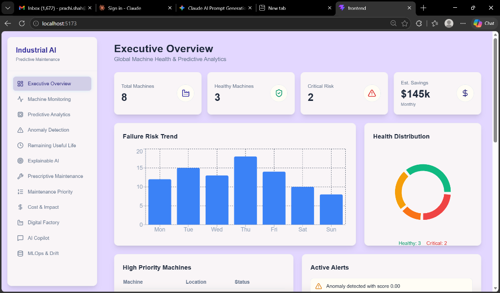
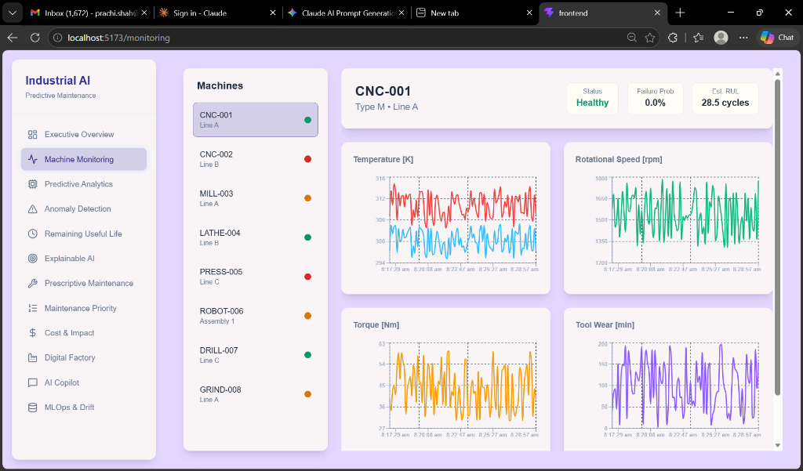
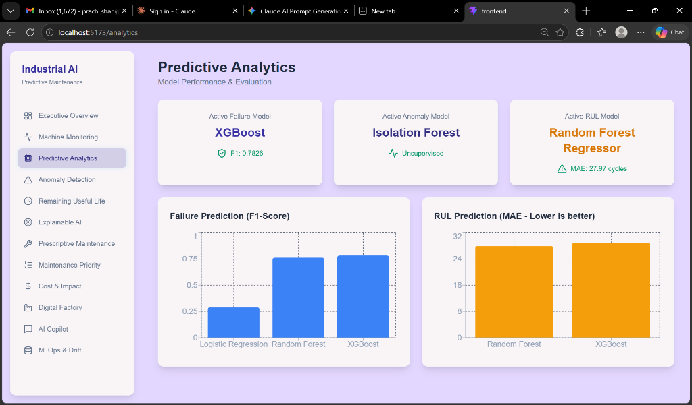
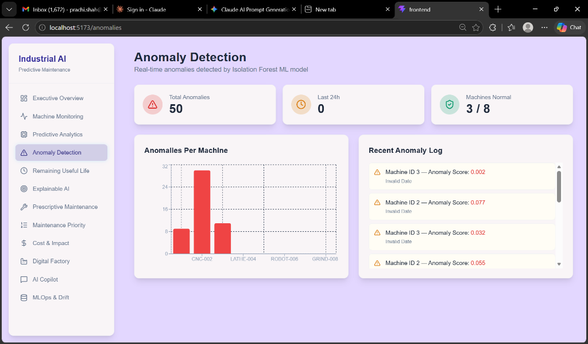
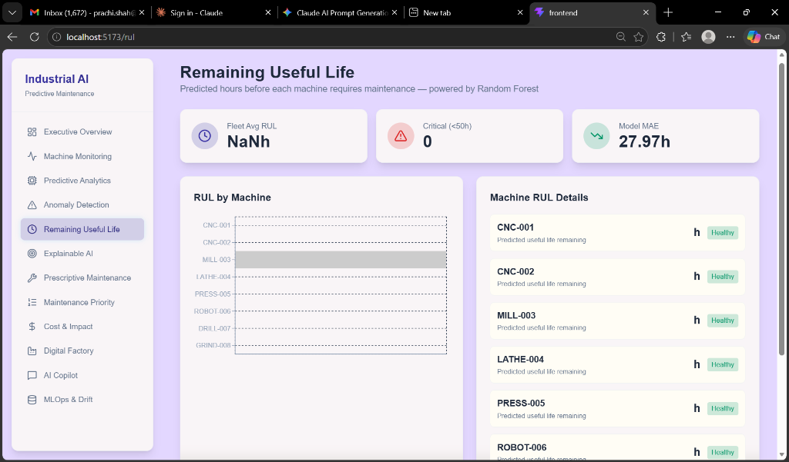
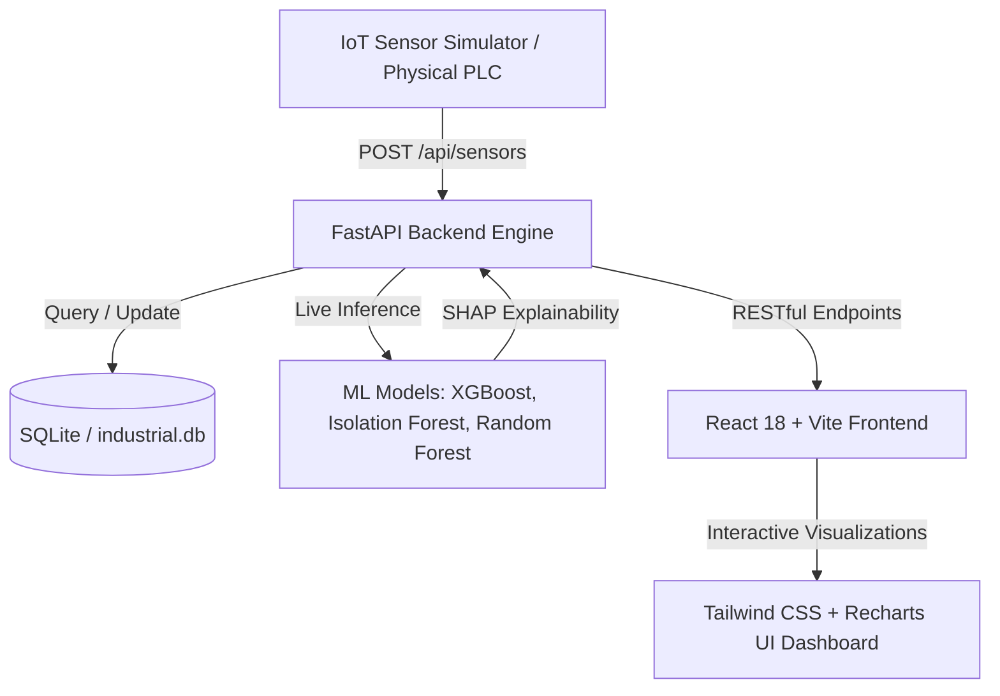

# 🏭 Industrial AI Predictive Maintenance Platform

[](https://www.python.org/)
[](https://fastapi.tiangolo.com/)
[](https://react.dev/)
[](https://tailwindcss.com/)
[](https://xgboost.readthedocs.io/)
[](https://scikit-learn.org/)
[](https://opensource.org/licenses/MIT)

> **An enterprise-grade, end-to-end Machine Health & Predictive Maintenance Platform.**  
> Continuously monitors industrial telemetry, predicts machine breakdowns before they occur using trained Machine Learning models, delivers explainability through SHAP values, and calculates the direct financial ROI of proactive maintenance.

---

## 📸 Platform Showcase

### 1. Executive Overview & Global Fleet Health
High-level KPIs summarizing machine fleet status, failure risk trends, health distribution, and active alerts across all manufacturing lines.


---

### 2. Real-Time Machine Telemetry Monitoring
Live streaming line charts tracking critical sensor variables (**Temperature [K]**, **Rotational Speed [rpm]**, **Torque [Nm]**, and **Tool Wear [min]**) updated dynamically.


---

### 3. Predictive Analytics & Model Benchmark
Interactive performance comparison and metrics for production-deployed models (XGBoost, Isolation Forest, Random Forest) evaluated on the benchmark dataset.


---

### 4. Unsupervised Anomaly Detection
Isolation Forest model capturing operational anomalies and outliers with severity scoring, machine breakdown charts, and real-time anomaly logs.


---

### 5. Remaining Useful Life (RUL) Forecasting
Random Forest regression model estimating remaining operating hours for each asset before critical failure, categorized into risk zones.


---

## ✨ Key Features & Business Impact

- ⚡ **Real-Time IoT Digital Twin**: Streams live sensor data through a background simulator mimicking physical factory floor machines.
- 🧠 **Triple-Model Machine Learning Engine**:
  - **Failure Classification (XGBoost)**: Predicts potential machine failures with an **F1-Score of 0.7826**.
  - **Outlier Detection (Isolation Forest)**: Detects unseen operational anomalies without supervision.
  - **RUL Prognostics (Random Forest Regressor)**: Estimates remaining useful life hours (**MAE: 27.97 hours**).
- 🔍 **Explainable AI (SHAP)**: Explains *why* a machine was flagged as high-risk by exposing exact feature contributions (e.g., heat dissipation vs. tool wear).
- 🛠️ **Prescriptive Maintenance Action Plans**: Provides automated 5-step corrective procedures customized to the identified failure mode.
- 💰 **Financial Impact & ROI Analysis**: Quantifies the business value of preventive maintenance vs. unplanned downtime costs ($4,500/hr downtime estimate).
- 🤖 **Interactive AI Maintenance Copilot**: Natural-language query interface allowing engineers to ask about machine risk, downtime costs, and fleet health.
- 🏭 **Digital Factory Twin Grid**: Visual layout of all machines with pulsing color-coded status badges and dynamic "+ Add Machine" creation modal.
- 🎨 **Modern Custom Industrial UI**: Soft Lavender (`#e3d7ff`) & Warm Cream (`#FFFDF5`) palette for maximum readability and visual appeal.

---

## 🧠 Machine Learning Overview

Trained on the **AI4I 2020 Predictive Maintenance Dataset** (10,000 synthetic industrial records representing multi-modal failure types):

| Model Task | Algorithm | Evaluation Metric | Production Result |
| :--- | :--- | :--- | :--- |
| **Machine Failure** | **XGBoost Classifier** | F1-Score / ROC-AUC | **F1: 0.7826** / **AUC: 0.8872** |
| **Anomaly Detection**| **Isolation Forest** | Unsupervised Score | Dynamic Outlier Severity |
| **Remaining Useful Life** | **Random Forest Regressor** | Mean Absolute Error (MAE) | **MAE: 27.97 hours** |
| **Feature Attribution** | **SHAP TreeExplainer** | Additive Shapley Values | Per-sensor contribution |

---

## 🏗️ System Architecture



---

## 📁 Repository Structure

```
ML_PROJECT/
├── backend/
│   ├── app/
│   │   ├── api/
│   │   │   └── endpoints.py      # REST API route handlers
│   │   ├── database/
│   │   │   └── database.py       # SQLAlchemy engine & session
│   │   ├── ml/
│   │   │   └── inference.py      # Real-time model prediction engine
│   │   ├── models/
│   │   │   └── domain.py         # SQLAlchemy database models
│   │   ├── schemas/
│   │   │   └── schemas.py        # Pydantic validation schemas
│   │   └── main.py               # FastAPI entrypoint & seed data
│   ├── simulator.py              # Virtual factory telemetry streamer
│   ├── feature_stats.json        # Training stats for drift detection
│   └── industrial.db             # Local SQLite database
├── frontend/
│   ├── src/
│   │   ├── pages/                # 12 Operational dashboard views
│   │   ├── layouts/
│   │   │   └── DashboardLayout.tsx # Navigation sidebar & layout
│   │   ├── services/
│   │   │   └── api.ts            # Axios HTTP client
│   │   ├── App.tsx               # Route configurations
│   │   └── index.css             # Tailwind base & theme config
│   ├── package.json
│   └── vite.config.ts
├── ml/
│   ├── models/                   # Serialized .pkl models & metrics
│   │   ├── failure_model.pkl
│   │   ├── anomaly_model.pkl
│   │   ├── rul_model.pkl
│   │   └── metrics.json
│   └── train_models.py           # Training, tuning & MLflow pipeline
├── docs/
│   └── screenshots/              # UI Demonstration images
└── README.md
```

---

## 🚀 Step-by-Step Installation & Run Guide

### 1. Prerequisites
- **Python 3.10+** (Tested on Python 3.13)
- **Node.js 18+** & **npm**
- **Git**

---

### 2. Installation

#### Clone the Repository:
```bash
git clone https://github.com/<your-username>/<your-repo-name>.git
cd ML_PROJECT
```

#### Set Up Python Virtual Environment:
```powershell
# Create virtual environment
python -m venv venv

# Activate virtual environment (Windows PowerShell)
venv\Scripts\activate
# (On macOS/Linux: source venv/bin/activate)

# Install backend dependencies
pip install fastapi uvicorn sqlalchemy pydantic pandas numpy scikit-learn xgboost shap joblib mlflow httpx pytest requests
```

#### Install Frontend Dependencies:
```bash
cd frontend
npm install
cd ..
```

---

### 3. Running the Application

To experience the complete real-time factory flow, open **3 separate terminal windows**:

#### **Terminal 1: Start Backend API**
```powershell
cd backend
..\venv\Scripts\activate
uvicorn app.main:app --reload --port 8000
```
> API will be running at: `http://localhost:8000`  
> Interactive Swagger docs: `http://localhost:8000/docs`

#### **Terminal 2: Start Virtual Sensor Simulator**
```powershell
cd backend
..\venv\Scripts\activate
python simulator.py
```
> Streams synthetic sensor readings for all machines every 5 seconds.

#### **Terminal 3: Start Frontend Dashboard**
```powershell
cd frontend
npm run dev
```
> Dashboard will be live at: **`http://localhost:5173`**

---

## 🧪 Testing

Run backend API and ML inference tests:
```powershell
cd backend
python -m pytest app/tests/test_api.py
```

Run frontend production build verification:
```powershell
cd frontend
npm run build
```

---

## 👨‍💻 Author

Developed as an end-to-end Demonstration of **Industrial AI & MLOps Predictive Maintenance**.  
Feel free to open an issue or submit a pull request!
